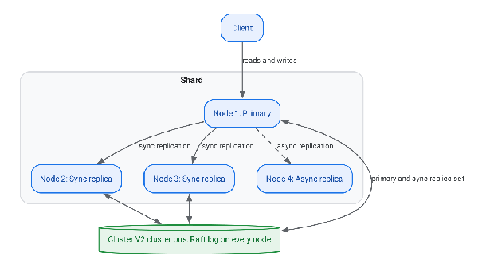
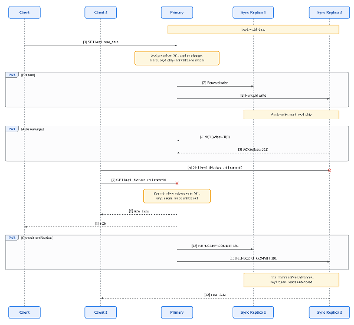
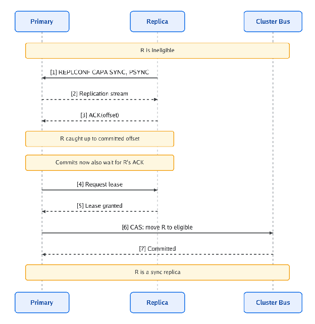
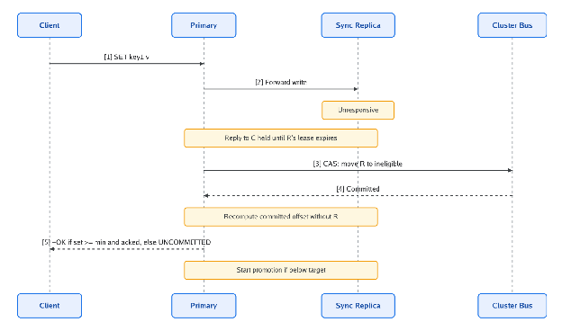
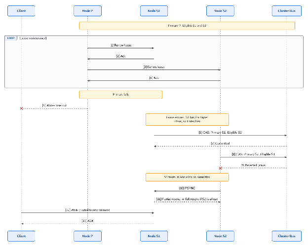
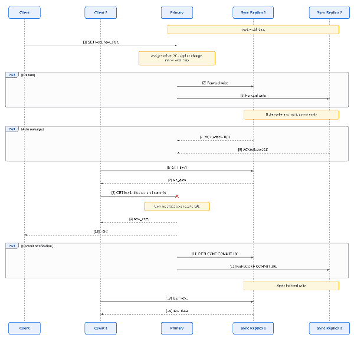

# Valkey Durability: Synchronous Replication Architecture

# Summary

Valkey is adding first-class durability through **synchronous replication**, using the PacificA primary/backup replication framework. The design has four main parts:

1. **Durability comes from synchronous replication.** The primary acknowledges a write only after every replica in the shard's *sync replica set* has received it.  
2. **Cluster V2, a new durable, Raft-based cluster bus, stores the shard configuration authoritatively.** That configuration covers which node is primary and which replicas are eligible to take over. Cluster V2 is introduced as part of this design and replaces today's gossip-based cluster bus.  
3. **Primary eligibility is committed to the cluster bus.** Only replicas that are fully caught up can become eligible for promotion, and that eligibility is recorded durably.  
4. **Bidirectional leases prevent stale reads.** Leases are implicit in replication traffic. A replica's acknowledgements renew the primary's lease, so a replica can take over only after that lease has expired. The primary's commit messages renew each sync replica's read lease, so the primary commits without a replica only after that replica's lease has expired. A deposed primary can't commit writes anyway, because it can no longer collect acknowledgements from its whole sync replica set. The leases make sure a node that loses its role also stops serving reads in time.

Durability is configured on the server with two settings, `min-sync-replicas` and `target-sync-replicas`. Both are set on every node, and the current primary's values take effect. A per-replica `sync-eligible` setting controls which replicas may join the sync replica set. The shard's primary promotes replicas until the sync replica set reaches the target, and it rejects writes whenever the set falls below the minimum. Clients don't need any changes.

The rest of this document gives the motivation, the requirements, the building blocks, the consistency guarantees, and the milestone plan. It consolidates the design discussion spread across the Valkey RFCs, GitHub issues, and draft PRs. See [References](#references).

# Background and Motivation

## The durability gap

Valkey clusters are built for low latency. A primary executes a write and acknowledges it immediately, and replicas receive the update asynchronously. This gives excellent throughput and tail latency, but it leaves a window in which an **acknowledged write can be lost** if the primary fails before any replica has the write.

The tools available today do not close that gap:

| Mechanism | Limitation |
| :---- | :---- |
| `WAIT <replicas> <timeout>` | Puts durability management on the application. A propagation-based ack does not guarantee durability across failover, replica changes, or slot migration, because a replica that never got the write can still be promoted. |
| AOF with `appendfsync always` | Durable on a single node only. AOF is not a true write-ahead log: a failed write or fsync can still leave the change in the AOF, so the client's view and the server's state can diverge. The synchronous fsync on the main thread also costs throughput. |
| `WAITAOF` | Same client-side complexity and the same single-node durability caveats as above. |

## Key durability challenges

Even with no bugs or operator errors, normal cluster behavior can cause an acknowledged write to be lost:

* **Leader election.** A write can be acknowledged and propagated to only some replicas. A different replica that never received the write can then be legitimately promoted, and the shard's authoritative history no longer includes that write.  
* **Slot migration rollback.** If the source shard broadcasts a higher config epoch after a migration has completed, the target shard can be forced to roll back ownership and discard writes it accepted in the meantime. A source-shard failover or a concurrent migration conflict can trigger this.  
* **Two-node shards.** With one primary and one replica, any durability guarantee costs availability. When one node fails, requests that need a durable ack must fail clearly and predictably.

The underlying problem is that a success from the primary today confirms **acceptance**, not a durable **commitment** that survives a topology change.

# Requirements

## Core durability principles

* **Separation of metadata and data.** The problem splits into two parts: consistent cluster metadata storage, and synchronous data replication. The cluster metadata is owned by a new Raft-based cluster bus. Shard data follows the existing replication path, with an added protocol for acknowledgement and commit.  
* **Authoritative acknowledgement.** A durable write's ack must be tied to a single, authoritative decision at the shard level. That keeps the ack valid through leader elections, slot migrations, and other topology changes.  
* **Membership awareness.** During a cluster change, durability confirmation must come from the nodes that will be the final, authoritative owners of the data. A "lame duck" set of nodes that is about to lose authority must not be able to confirm a write.  
* **Favor clear failure modes.** If a durable write can't be confirmed in time, the server returns an explicit error. Then the client knows the writer's state is unknown and can retry safely, provided the operation is idempotent. Some outcomes are unavoidably ambiguous (crashes, connection drops, failovers), but whenever the server has a choice, it returns an explicit error.

## Interface and usability

* **Durability is a property of the shard, not of the request.** Operators configure durability on the server. Every write to a durable shard is durable, and clients don't need to change anything. The settings are configured per node, and the current primary's values determine the shard's behavior.  
* **Simple, declarative controls.** Two settings describe the operator's intent: the *target* number of sync replicas to maintain, and the *minimum* number below which the shard stops accepting writes. A per-replica `sync-eligible` flag marks which replicas may become sync replicas.  
* **Explicit, predictable degradation.** A shard below its target but at or above its minimum keeps serving, and the degraded state is visible to operators. A shard below its minimum rejects writes with an explicit error.

## Architectural constraints

* **No regression for non-durable workloads.** Workloads that don't need strong durability keep their current performance and never pay quorum-commit I/O or network costs.  
* **Foundation for future features.** The mechanism should support future capabilities such as data tiering.  
* **Self-sufficient high availability.** Valkey manages its own state, consensus, and replication, with no dependency on specialized external or infrastructure-level durability mechanisms.

# Design Decision: Synchronous Replication over Raft-Based Data Replication

Two approaches were explored for the data path:

1. **Raft-based data replication** ([valkey-rfc\#33](https://github.com/valkey-io/valkey-rfc/pull/33), [valkey\#3019](https://github.com/valkey-io/valkey/issues/3019)). Every write goes through a Raft log, replicas defer execution until commit, and commit requires a majority quorum.  
2. **PacificA-style synchronous replication** ([valkey\#3037](https://github.com/valkey-io/valkey/issues/3037), [valkey\#3704](https://github.com/valkey-io/valkey/pull/3704)). Valkey's existing primary/replica replication stream is extended with a commit protocol. Consensus is used only for the low-volume configuration metadata.

**The project is proceeding with synchronous replication.** Raft-based data replication is deferred as possible future work. The reasons:

* **Two-node shards keep working through a failure.** One primary with one replica is one of the most common Valkey deployments. With majority-quorum replication, a two-node shard can neither commit writes nor elect a new primary once either node fails, because a majority of two is two. With PacificA, the shard's configuration lives in the cluster bus, whose quorum spans the whole cluster, and a write commits once every replica in the current configuration has it. When either node fails, the configuration is changed to drop it. If the primary fails, the replica holds every committed write and takes over. If the replica fails, the primary continues alone when `min-sync-replicas = 0`, or rejects writes when it is `1`. More generally, a shard of N sync replicas plus the primary tolerates up to N failures without losing committed data, while majority-quorum replication needs 2f+1 copies to tolerate f failures.  
* **Data and consensus are separated.** In PacificA, consensus manages only configuration, which here lives in the Cluster V2 cluster bus: who is primary and who is in the sync replica set. The data path stays a simple primary/backup stream. This matches how Valkey works today and keeps the high-throughput data path free of per-write consensus overhead.  
* **Existing replication is reused.** Valkey's `primary_repl_offset` is already a monotonically increasing, gap-free sequence for every write. It fills the role of PacificA's serial number, so no new log format or counter is needed. The *committed offset* is PacificA's commit point, expressed in bytes.  
* **Disks are optional.** Durability comes from fully synchronous copies on independent replicas. On-disk persistence is an additional, independent option. Operators who want less chance of data loss can independently configure local persistence node-wise (AOF, RDB, fsync always). Operators who want strong consistency or pure in-memory redundancy without disk I/O can skip it, so long as they are comfortable with pure in-memory redundancy. This applies to data only: Cluster V2 always persists its Raft state (term, vote, and log) to local disk, because Raft isn't safe without it. See section 6\.  
* **Delivery is incremental.** Each building block (write-behind AOF, the sync replication commit protocol, Cluster V2) is useful on its own and can ship separately.

# Architecture Overview

The architecture is split into a **control plane**, the Cluster V2 cluster bus, which manages cluster metadata, and a **data plane**, which replicates writes.

* **Control plane: the Cluster V2 cluster bus.** A new Raft-based cluster bus that runs on the Valkey nodes themselves. It durably and consistently stores each shard's configuration (primary, eligible replicas, ineligible replicas) and slot ownership. In this design, the cluster bus acts as PacificA's configuration manager (its metadata store). There is no separate metadata service.  
* **Data plane: synchronous replication.** The primary streams writes to its replicas over the existing replication link. A write is committed, and the client is acknowledged, only once every replica in the sync replica set has acknowledged it. Async replicas receive the stream only up to the committed offset, and never sit on the write's critical path.  
* **The Raft leader and the data primary are independent.** Any node can be the Raft leader. Data-plane primaryship is just a value stored in the cluster bus log.

# Building Blocks

## 1\. Dirty key tracking and reply blocking

**Tracking:** [valkey\#3993](https://github.com/valkey-io/valkey/issues/3993) (Milestone I), [valkey\#3381](https://github.com/valkey-io/valkey/pull/3381)

The foundation for every durability mode is a mechanism that **delays replies, not command execution**, until a write is durable. It is called the Dirty Key Tracker, or reply blocking.

* **Execute immediately, hold the reply.** A command runs right away and its reply goes into the client output buffer (COB). A byte-precise boundary in the COB stops the networking layer from flushing past it until the *committed offset* catches up. A pipelined client can have several boundaries, which unblock one after another.  
* **Uncommitted key tracking.** Modified keys are tracked per database, together with the replication offset at which they were dirtied. A **read** of an uncommitted key is reply-blocked just like a write, so no client ever sees uncommitted state. This includes non-replicating replies, such as `SETNX` returning `0` because of a write that isn't durable yet.  
* **Keyspace-wide reads.** Commands that read the keyspace as a whole, not specific keys (`SCAN`, `KEYS`, `RANDOMKEY`, `DBSIZE`, `INFO keyspace`), can't be checked key by key. Their replies are held until the node's committed offset reaches the applied offset at the time the command ran.  
* **Expiry and eviction.** Deletes caused by expiry or eviction are replicated writes, so the deleted key is marked dirty like any other write. A read that finds a key missing because it was just expired or evicted is held until that delete commits. Otherwise a client could read nil and then, after a failover, read the old value again.  
* **Deferred client side effects.** Client keyspace notifications (pub/sub) and client-side caching invalidations are deferred until the write is durable. Module keyspace notifications follow different rules, described in [section 3](#3-module-keyspace-notifications).  
* **fsync moves off the main thread.** For local durability (`appendfsync always`), AOF write and fsync run as a background job. The main thread keeps serving other clients while the fsync is in flight, and the zero-data-loss guarantee is preserved.

The *committed offset* is the single abstraction that every durability source feeds. In Milestone I it is the AOF fsync offset. With synchronous replication it also covers replica acknowledgements, and durability can be configured as AOF **and** sync replication together.

## 2\. Synchronous replication commit protocol

**Tracking:** [valkey\#4028](https://github.com/valkey-io/valkey/issues/4028) (Milestone II), [valkey\#3704](https://github.com/valkey-io/valkey/pull/3704)

The commit protocol follows the PacificA framework. A **sync replica** is a replica that counts toward durability. It corresponds to a "replica in the configuration" in PacificA terms.

**Durability configuration**

Two settings are configured on each node. Only the current primary's values take effect: replicas' values are ignored until they are promoted, and a newly promoted primary applies its own values. Set the same values on every node in a shard, so behavior doesn't change after a failover:

| Setting | Meaning |
| :---- | :---- |
| `target-sync-replicas` | The number of sync replicas the primary maintains. `0` disables synchronous replication, and the shard behaves exactly like Valkey does today. The default value would be `-1` to mean “all `sync-eligible` replicas”. |
| `min-sync-replicas` | The minimum number of sync replicas needed to accept writes. Must be ≤ `target-sync-replicas`. `0` means the shard keeps accepting writes even with no sync replicas (default, fail-open). |

**On the primary**

* **Reaching the target.** Whenever the sync replica set is smaller than `target-sync-replicas`, the primary promotes caught-up, sync-eligible replicas until it reaches the target, using the [promotion flow](#promotion-async-replica-to-sync-replica). This runs continuously: at startup, after a sync replica is demoted, and after a failover.  
* **Enforcing the minimum.** If the sync replica set is smaller than `min-sync-replicas`, the primary rejects new writes with an explicit error (`CLUSTERDOWN`). See [Write behavior during faults](#write-behavior-during-faults).  
* **Commit rule.** The primary's committed offset is the minimum acknowledged offset across the sync replica set (combined with the local AOF fsync offset when AOF durability is on). A write's reply is released once the committed offset reaches the write's offset. The committed offset never moves backward, and it advances only while the sync replica set has at least `min-sync-replicas` members. While the set is below the minimum, it stays where it is. With `min-sync-replicas = 0` and an empty set, the committed offset is the primary's own replication offset (or its AOF fsync offset when AOF durability is on).  
* **Fault tolerance.** A shard at its target stays writable through `target-sync-replicas - min-sync-replicas` sync replica failures. Committed data survives as long as the primary or at least one eligible sync replica survives. With `min-sync-replicas = 0`, writes committed while the set was empty exist only on the primary.

**On replicas**

* `sync-eligible` (`yes` or `no`) marks a replica as a candidate for the sync replica set. Unlike the two settings above, each replica's own value applies. Replicas that aren't sync-eligible are never promoted, so operators can deploy 1 primary \+ sync-eligible replicas \+ async read replicas. All asynchronous replication, including async replicas and cross-region replication, receives the stream only up to the primary's committed offset, so it never holds uncommitted writes. Only sync replicas receive writes before they commit, because their acknowledgements are what commits them. As a result, an async replica is never ahead of a new primary and normally continues with a partial resync after failover.  
* A sync-eligible replica advertises itself during the replication handshake (`REPLCONF CAPA SYNC`) and catches up through the normal PSYNC and replication stream.  
* The primary sends its committed offset to replicas with `REPLCONF COMMIT <offset>`, either as its own message or piggybacked on the replication stream.  
* A sync replica's `REPLCONF ACK <offset>` means it has received and applied the stream up to that offset. If the replica has `appendfsync always`, it acknowledges only after the AOF fsync for that offset completes, so a shard that uses both AOF and sync replication survives every node losing power at once.

**The committed offset is a per-node view**

Every node tracks its own committed offset, and reply unblocking on a node depends only on that node's local view:

* **On the primary**, the committed offset is computed from sync replica acknowledgements, as described above.  
* **On a replica**, the committed offset is the last value received in `REPLCONF COMMIT`. It can trail the primary's but is never ahead of it.  
* As a result, a key can already be clean on the primary while it is still dirty on a replica. Replica reads of that key are held a little longer, but they never return uncommitted data.  
* **On promotion**, a new primary's local view can be behind writes the old primary had already acknowledged. Following PacificA, the new primary treats every write in its log as committed once it has reconciled with the remaining sync replicas, and only then serves clients. See [Leases, fault detection, and failover](#5-leases-fault-detection-and-failover).

### **Write path**

Sync replicas use **dirty key tracking**. They apply each write as soon as it arrives but treat the modified keys as dirty, and a read of a dirty key is held until the replica's committed offset passes the write. This makes reads from sync replicas linearizable while the replica holds a read lease.

A write-ahead mode for sync replicas is deferred and tracked separately in the **Deferred: Write-ahead replica reads** section. In that mode, replica reads never block but are only serializable.

**Note on read concern.** Today a client can't ask for a particular read consistency. `READONLY` is the only replica-read option, and `READONLY` reads keep being served after a sync replica is demoted to async. Until a read concern protocol exists (see Future Work), clients can't rely on linearizable reads from replicas. The lease rules in this design are in place so that it can be added later without protocol changes.

## 3\. Module keyspace notifications

**Tracking:** [valkey\#4027](https://github.com/valkey-io/valkey/issues/4027)

Reply blocking holds replies, not command execution. So modules that subscribe to keyspace notifications can see a write before it is durable. Modules fall into two classes with conflicting needs:

| Consumer class | Examples | Needs |
| :---- | :---- | :---- |
| **Change-time consumers** | Secondary indexes (such as ValkeySearch), in-process caches, idempotent fan-out | To see each change inline, in the same order as the keyspace, so derived state stays consistent with the data |
| **Durability-sensitive consumers** | Forwarding to external systems, audit logs, change data capture | To know a write is durable before acting on it externally |

The engine can't tell which class a module belongs to, so modules handle the distinction themselves, using the durable offset API below.

### **Inline delivery**

Module keyspace notifications are always delivered inline, at the moment the keyspace is modified and before the write is durable. This is the only delivery mode, for these reasons:

* **Module client blocking** on keyspace events ([valkey\#1819](https://github.com/valkey-io/valkey/issues/1819)) only works correctly with inline delivery.  
* **No stale-value hazard.** Reply blocking doesn't stop a second write to the same key from executing before the first write commits. A deferred callback could therefore read a newer value than the one it was notified about, which breaks read-after-write for change-time consumers.  
* **Consistent with other module APIs**, which already observe state that isn't durable yet.

An inline notification can describe a write that never commits. For example, the primary fails before the write commits, and every replica that already applied it is fully resynced from the new primary. Modules that keep derived state must treat inline notifications as provisional until durable. A full resync raises the existing flush and loading server events, which modules use to rebuild their derived state.

### **Durable offset API**

Modules get a generic way to learn when writes become durable, and to tell the core how far they have processed:

| API | Purpose |
| :---- | :---- |
| `VM_GetCurrentOffset()` | Returns the node's applied offset: the latest write that has executed. |
| `VM_GetDurableOffset()` | Returns the node's committed offset: the latest write that is durable under the configured policy (AOF fsync and/or sync replica acknowledgements). This is the node's local view, as described in section 2\. |
| `ValkeyModuleEvent_DurableOffsetAdvanced` | A server event that fires when the node's committed offset advances, and carries the new committed offset. |
| `VM_SetConsumedOffset(ctx, offset)` | Lets a module report the highest applied offset it has fully processed, for example indexed. The core uses it during slot migration. |

**Example: read-committed secondary index**

1. On each keyspace notification, the module records `VM_GetCurrentOffset()` with the mutation.  
2. As mutations are applied to the index, the module tracks the highest offset it has ingested (the index offset).  
3. On a query such as `FT.SEARCH`, the module holds the response until `VM_GetDurableOffset()` reaches the index offset. It releases held queries from its `DurableOffsetAdvanced` event handler. Query results never reflect uncommitted writes.

**Example: slot migration.** Slot migration needs the reverse direction: before the target shard takes ownership of a slot, the core must know that modules on the target have processed the migrated data. A module that keeps derived state reports its progress with `VM_SetConsumedOffset`. Before atomic slot migration finalizes on the target, the core waits until every module that has reported a consumed offset has reached the applied offset of the migrated data. Modules that never call `VM_SetConsumedOffset` aren't waited on.

### **Design choices**

* **Durable offset notification is a persistent server event, not a per-offset callback.** Modules subscribe once to `ValkeyModuleEvent_DurableOffsetAdvanced` through the existing server event mechanism. The event fires on the main thread at most once per event loop iteration, with the latest committed offset. Committed offsets only increase, so one event covers every earlier offset. Coalescing is built in, and modules never register per write.  
* **Durability-sensitive consumers build on offsets, not on delayed notifications.** A module such as a change data capture forwarder records `VM_GetCurrentOffset()` with each inline notification, buffers the change, and forwards it once `DurableOffsetAdvanced` reports a committed offset at or past it. This keeps a single notification path in the core.  
* **Consumed offsets are pushed by the module.** The core never calls into a module to ask how far it has processed. Modules report progress with `VM_SetConsumedOffset`, which keeps module code off the core's critical path.

## 4\. Shard configuration: primary, eligible, and ineligible nodes

Cluster V2 stores each shard's membership as durable, consistent metadata in its Raft log. Each node has one of three roles:

| Role | Meaning |
| :---- | :---- |
| **Primary** | The node that accepts writes. |
| **Eligible** | Sync replicas. They may be promoted to primary. |
| **Ineligible** | Async replicas and replicas still catching up. They may not be promoted. |

All changes go through a compare-and-set against the shard's configuration in the cluster bus, so only one of any set of concurrent conflicting changes can succeed. Two ordering rules keep the set of nodes that confirms a write identical to the set that can become primary:

* A replica must count toward commits **before** it becomes eligible.  
* A replica must be ineligible **before** any write commits without its acknowledgement.

A replica that joins the shard is added as ineligible.

### **Promotion: async replica to sync replica**

The primary starts a promotion whenever the sync replica set is below `target-sync-replicas` and a sync-eligible replica is connected. Promotions run one replica at a time.

1. **Catch up.** The replica syncs through PSYNC and the replication stream. The primary waits until the replica's acknowledged offset is at or past the primary's committed offset and its replication lag is within threshold.  
2. **Start counting its acks.** The primary adds the replica to its commit calculation. From now on, a write commits only after this replica has also acknowledged it. This is stricter than needed, so it is always safe. Steps 1 and 2 happen together on the main thread, with no event loop iteration in between, so the committed offset can't move past the replica's acknowledged offset in the gap. From then on, the committed offset can't pass the replica's acknowledged offset, so the replica still has every committed write when it becomes eligible in step 4\. Step 2 is also when the primary stops capping the stream at the committed offset for this replica and starts sending it writes that haven't committed yet.  
3. **Establish leases.** Both leases start from the replication traffic already flowing: the replica's REPLCONF ACK starts the primary's lease, and the primary's REPLCONF COMMIT starts the replica's read lease. No separate lease messages are needed.  
4. **Commit to the cluster bus.** The primary proposes a compare-and-set that moves the replica from *ineligible* to *eligible*. Once it commits, the replica counts toward `min-sync-replicas` and can be promoted to primary on failover.

If the replica falls behind or fails before step 4, the primary simply removes it from the commit calculation. It was never eligible, so no cluster bus change is needed. If the compare-and-set fails because the primary has lost primaryship, the primary steps down.

### **Demotion: sync replica to async replica**

The primary demotes a sync replica when its lease can't be renewed, when its replication lag passes the threshold, when it disconnects, when it is no longer sync-eligible, or when `target-sync-replicas` is lowered.

1. **Keep requiring its acks.** Until the demotion commits, writes still need this replica's acknowledgement, so their replies stay held. Write latency rises, but nothing is acknowledged without the replica.  
2. **Wait out the replica's read lease, then commit to the cluster bus.** The primary waits until the replica's read lease must have expired, measured from the last acknowledgement it received from that replica. It then proposes a compare-and-set that moves the replica to ineligible. For a planned demotion of a healthy replica, the primary can instead tell the replica to drop its read lease, and proceed once the replica confirms.  
3. **Stop counting its acks.** Once the change commits, the primary removes the replica from its commit calculation and recomputes the committed offset. Held replies whose writes have been acknowledged by the remaining sync replicas are released.  
4. **Check the minimum and the target.** If the set is now below `min-sync-replicas`, new writes are rejected (see [Write behavior during faults](#write-behavior-during-faults)). If it is below `target-sync-replicas`, the primary starts a promotion.

If the compare-and-set can't commit because the primary is partitioned from the cluster bus quorum, the demotion never completes and replies stay held. The partitioned primary eventually loses its lease and is replaced. It can't silently drop durability.

## 5\. Leases, fault detection, and failover

**Tracking:** [valkey\#3869](https://github.com/valkey-io/valkey/issues/3869)

### **Leases**

Leases run in both directions between the primary and each eligible replica. They are implicit in replication traffic that already flows, so there are no separate lease messages.

| Lease | Holder | Promise from the other side | Renewed by | Protects |
| :---- | :---- | :---- | :---- | :---- |
| **Primary lease** | Primary | The replica won't try to take over until the lease expires. | The replica's `REPLCONF ACK`, which confirms it has received the stream up to an offset. | Linearizable reads on the primary |
| **Replica read lease** | Sync replica | The primary won't commit a write without this replica's acknowledgement until the lease expires. | The primary's `REPLCONF COMMIT`, which echoes the replica's latest acknowledged offset. | Linearizable reads on the sync replica |

**Timing.** Each holder measures its lease from when it *sent* the message that the other side's reply confirms. Each grantor measures its promise from when it *received* that message. A message is always received after it is sent, so the holder's lease always expires before the grantor's promise does. Both sides use monotonic clocks and subtract a clock-drift margin.

* **Primary lease:** it runs from when the primary sent the stream data at offset X, once a `REPLCONF ACK` for offset X arrives. The replica won't try to take over until one lease duration after it last received traffic from the primary.  
* **Replica read lease:** it runs from when the replica sent its `REPLCONF ACK` for offset X, once a `REPLCONF COMMIT` echoing X arrives. The primary won't commit without that replica until one lease duration after it last received an acknowledgement from it.

**Lease durations.** The replica read lease is, by default, shorter than the primary lease. The read lease, plus the time to commit a demotion to the cluster bus, plus the clock-drift margin, must be less than the primary lease. Then when a sync replica fails:

* The primary waits only for the short read lease before it demotes the replica. Writes stall for that window, and no longer.  
* The demotion commits before the primary's own lease from that replica would expire. So the primary normally doesn't have to stop serving reads. Committing to the cluster bus has no hard upper bound on latency (for example, during a Raft leader election). If the demotion takes longer, the primary stops serving reads until it commits.

The longer primary lease only matters when the primary itself fails or is partitioned. It sets how long a replica waits before taking over.

**Idle shards.** With no writes, the primary still sends periodic heartbeats in the replication stream (`PING` and `REPLCONF COMMIT`), and replicas still send `REPLCONF ACK`. Both intervals are well within the replica read lease, the shorter of the two.

**When a lease can't be renewed:**

* **The primary** stops serving reads before its lease from any eligible replica expires, unless it has already demoted that replica. Because the read lease is shorter, a failed replica is normally demoted first, so in practice this only happens when the primary itself is partitioned from its replicas and the cluster bus.  
* **A sync replica** stops serving linearizable reads before its read lease expires. It keeps serving reads the way an async replica does, which are serializable. Because clients can't ask for linearizable reads yet (see the note on read concern in section 2), this has no visible effect today. The rule is there for linearizable replica reads later.  
* **A demotion waits out the replica's read lease.** The primary commits without a replica only after that replica's read lease must have expired and the demotion has committed to the cluster bus. Lease expiry alone isn't enough: until the demotion commits, the replica is still eligible and could be promoted on failover, so committing without it could lose writes. See the demotion flow in section 4\.

**Fault detection:**

* If the **primary** can't renew its lease from a replica, it demotes that replica using the demotion flow in section 4\.  
* If a **replica** sees the primary's lease expire, it tries to move the primary to *ineligible* and promote itself. If several replicas try at once, the compare-and-set lets exactly one win. A partitioned replica can't promote itself.  
* **The most up-to-date replica is preferred (best effort).** Each eligible replica waits before its attempt, with a delay based on its rank by replication offset among the eligible replicas. The replica with the highest offset normally goes first. Any eligible replica is safe to promote, because each one holds every committed write. Preferring the most up-to-date one keeps full resyncs after failover to a minimum.

**Writes can't split-brain.** A deposed primary can't commit, because the replica that replaced it, and the cluster bus configuration, no longer let it collect acknowledgements from its whole sync replica set.

**Leases prevent stale reads in both directions.** A replica takes over only after the old primary's lease has expired, and a primary commits without a replica only after that replica's read lease has expired. In both cases, the node that lost its role has stopped serving reads before anything newer commits without it.

**Leases across a failover.** These rules carry the lease guarantees through a change of primary:

* **A deposed primary stops granting read leases.** A primary stops renewing replica read leases (it stops sending `REPLCONF COMMIT` that echoes new acknowledgements) as soon as any primary lease it holds has expired. A deposed primary has lost its lease from the replica that replaced it, so it can't keep a sync replica serving stale reads after the takeover.  
* **The new primary waits out old read leases.** After taking over, the new primary doesn't commit without any replica from the old configuration, and doesn't demote one, until one read lease duration plus the clock-drift margin has passed since the takeover committed. The old primary stopped granting read leases before the takeover, so by then every read lease it granted has expired.  
* **Takeover timers restart on a configuration change.** A replica starts timing a new primary's lease when it learns of the configuration change from the cluster bus, as if it had just received traffic from the new primary.  
* **Restarts.** Lease state is kept in memory. A node that restarts waits one full lease duration before it attempts a takeover or serves reads under a lease.

### **Write behavior during faults**

Writes are never reported as successful until they commit. While a fault is being handled, clients see delayed replies or explicit errors, never a false success:

| Phase | Writes | Reads |
| :---- | :---- | :---- |
| A sync replica is unresponsive and its read lease hasn't expired yet | Accepted and executed, but replies are held until the replica acknowledges or is demoted. Clients see higher latency, not errors. | Reads of keys written during this window are held. Other reads are served normally. |
| Demotion committed, sync replica set ≥ `min-sync-replicas` | Held replies are released as soon as the remaining sync replicas have acknowledged. New writes proceed normally. | Normal. |
| Demotion committed, sync replica set \< `min-sync-replicas` | New writes are **rejected before execution** with `CLUSTERDOWN`. Writes that already executed are **released immediately** with an `UNCOMMITTED` error. | Reads of keys with uncommitted writes are released with `UNCOMMITTED`. Other reads are served normally. |
| A replica is promoted and the set is back to ≥ `min-sync-replicas` | Writes are accepted again. | Normal. Keys with uncommitted writes become readable once those writes commit. |

**Two errors with different meanings:**

* **`CLUSTERDOWN`**: the write was rejected before it executed. It definitely didn't happen and is safe to retry.  
* **`UNCOMMITTED`**: the write executed on the primary but couldn't be committed, so **its outcome is unknown**. It may still commit later, for example when a replica that already received it is promoted into the sync replica set, or it may be lost in a failover. Clients should treat it like a timeout: retry only idempotent operations, or read the key back to check.

A primary that steps down while replies are held also returns `UNCOMMITTED` for them, because the new primary decides whether those writes survive.

### **Failover**

**After failover**, the new primary applies the `target-sync-replicas` and `min-sync-replicas` settings, and it promotes remaining caught-up replicas to restore the target.

**Reconciliation.** Every eligible replica holds every committed write, so the new primary is guaranteed to have the full committed history. The remaining replicas reconnect to the new primary with PSYNC, fenced by the shard's configuration epoch. A replica at or behind the new primary's offset continues with a partial resync. Sync replicas apply writes as they arrive (write-behind), and applied writes can't be undone. So a replica that is ahead of the new primary, because it applied writes that never committed, needs a full resync. To keep this rare, failover prefers the most up-to-date replica (best effort, see fault detection above). Discarding an uncommitted tail without a full resync requires write-ahead replicas, which are future work.

**Committing the new primary's tail.** The new primary's log can extend past the old primary's committed offset. Following PacificA, that tail is kept, and it commits the normal way: once every replica in the new sync replica set has acknowledged it. Replicas that are still eligible but ahead of the new primary can't acknowledge until a full resync finishes, so the new primary demotes them with the normal demotion flow (including the read lease wait above) and promotes them again after they catch up.

**Manual failover** uses a fence. The old primary records a *fenced* state in the cluster bus and stops accepting writes. The target replica catches up to the old primary's offset, and then commits itself as the new primary.

**No eligible replica.** If the primary fails while the sync replica set is empty (possible only with `min-sync-replicas = 0`), no replica is eligible, so automatic failover doesn't happen. The shard is unavailable until the primary comes back. That is stricter than today, where an async replica is promoted and recent writes are lost.

**Forced failover.** `CLUSTER FAILOVER FORCE` and `TAKEOVER` commit the target as primary through the same compare-and-set, without waiting for the old primary's lease to expire. If the target is eligible, no committed write is lost, but the old primary may serve stale reads until its lease expires. If the target is ineligible, committed writes it doesn't have are lost. Both are explicit operator actions, recorded in the cluster bus and visible to operators.

## 6\. Cluster V2 cluster bus

**Tracking:** [valkey\#3856](https://github.com/valkey-io/valkey/issues/3856), [Cluster Raft design](https://github.com/valkey-io/valkey/blob/cluster-v2/design-docs/cluster-raft.md)  
Cluster V2, the new durable, Raft-based cluster bus, is specified in its own design. Its safety, combined with this protocol, is checked as described in Verification. This design relies on the following properties of it:

* **Durable, totally ordered shard configuration**: the primary, and the eligible and ineligible replicas.  
* **Compare-and-set updates**, so exactly one of any set of concurrent conflicting changes commits.  
* **Primaryship is data in the log.** A node syncs to the latest log before it serves as a primary or re-enters the cluster.  
* **Persistent Raft state.** Raft is safe only if each node keeps its term, vote, and log across restarts. Cluster V2 always persists them to local disk, even on nodes that keep no data on disk (like nodes.conf).  
* **Restarted nodes rejoin as ineligible.** Each node has an incarnation ID that changes whenever it restarts without its data. The shard configuration records the incarnation of each eligible replica, and the takeover compare-and-set checks it, so a node that comes back empty can't be promoted. It rejoins as an ineligible replica and becomes eligible again only through the promotion flow.  
* **Correlated data loss is detected.** If every member of the sync replica set loses its data at once (for example, a zone outage with no local persistence), committed writes are lost. No eligible replica has a matching incarnation, so the shard stays unavailable until an operator recovers it, instead of silently serving a truncated history. Spreading sync replicas across failure domains, or turning on AOF, guards against this.  
* **Slot ownership and migration fencing.** Slot assignments and migration fences are committed to the cluster bus, so two shards can never own a slot at once. This removes the slot migration rollback scenario described in the background section.  
* **Self-contained.** It runs on the Valkey nodes, with no external coordination service.

# Consistency and Durability Properties

| Property | Guarantee |
| :---- | :---- |
| Acknowledged writes | Survive as long as the primary or at least one eligible sync replica survives. With `min-sync-replicas = 0`, writes committed while the sync replica set was empty exist only on the primary. |
| Reads from the primary | **Linearizable.** |
| Reads from sync replicas | Linearizable while the replica holds a valid read lease. Sync replicas use dirty key tracking to hold responses for keys that aren't committed yet. Without a valid lease, reads degrade to serializable. Clients can't ask for linearizable replica reads yet (see the note on read concern in section 2). |
| Reads from async replicas | **Serializable.** They may lag, but never show uncommitted data, because they only receive committed writes. |
| Uncommitted data | Never returned by core commands on any node. Modules can observe uncommitted writes through inline keyspace notifications and other module APIs (see section 3), so a module that serves queries must hold results until they are durable. |
| Disks | Optional. Strong consistency doesn't require local persistence, and AOF can be combined with sync replication for more durability. |

### **Example: availability with** `target-sync-replicas = 2` **and** `min-sync-replicas = 1`

Consider a shard with primary N1, sync replicas N2 and N3, and async read replica N4:

| Scenario | Shard writable? | Reason |
| :---- | :---- | :---- |
| N4 fails | Yes | N4 is a read replica, so the sync replica set is unchanged. |
| N2 fails | Yes (degraded) | Sync replica set size (1) ≥ `min-sync-replicas` (1). The primary tries to promote another sync-eligible replica to get back to the target (2). |
| N2 and N3 fail | No | Sync replica set size (0) \< `min-sync-replicas` (1). Writes fail with an explicit error until a replica catches up and is promoted. |
| N1 fails | Yes, after failover | N2 or N3 takes over. The new primary has 1 sync replica (≥ min) and promotes another sync-eligible replica to get back to the target. |

### **Two-node shards**

With one primary and one sync replica, losing either node means writes can't be durably acknowledged. Operators pick the tradeoff with the settings. `target-sync-replicas = 1` with `min-sync-replicas = 1` is **fail-closed**: writes are rejected while the replica is unavailable. `target-sync-replicas = 1` with `min-sync-replicas = 0` is **fail-open**: the shard falls back to asynchronous operation. Fail-open is an explicit operator choice and is always visible, never a silent downgrade.

# Configuration and Client Interface

* **Server-side configuration.** `target-sync-replicas` and `min-sync-replicas` are configured per node, but **only the current primary's values take effect**. Replicas' values are ignored until they are promoted, and a newly promoted primary applies its own values. Operators should set the same values on every node in a shard, so behavior doesn't change after a failover. `target-sync-replicas = 0`, the default, keeps today's asynchronous behavior with no performance cost.  
* **No client changes.** In a durable shard, every write is acknowledged only after it commits. Applications don't call `WAIT` or opt in per connection.  
* **`WAIT` is not the durability mechanism.** `WAIT` keeps its current best-effort semantics for compatibility, but the durability guarantees in this design don't depend on it.  
* **Errors.** Writes rejected before execution because the shard is below `min-sync-replicas` get `CLUSTERDOWN` and are safe to retry. Writes that executed but couldn't commit get `UNCOMMITTED`, and their outcome is unknown. See "Write behavior during faults" in section 5\.  
* **Cluster mode only.** Synchronous replication relies on Cluster V2 for the shard configuration, so durable shards are supported only in cluster mode. Standalone and Sentinel deployments keep today's asynchronous replication.  
* **Topology exposure.** `CLUSTER SHARDS` and `CLUSTER NODES` keep reporting sync replicas with the replica role, for backward compatibility. Sync replicas get extra metadata (for example, a sync flag) so clients that want stronger read guarantees can route reads to them.

# Cross-Feature Interactions

| Feature | Status | Interaction with synchronous replication |
| :---- | :---- | :---- |
| **Throttling infrastructure and replication throttling** ([\#3963](https://github.com/valkey-io/valkey/issues/3963), [\#4356](https://github.com/valkey-io/valkey/pull/4356)) | Merged for 9.2 | Throttling pauses a client by removing its read handler and releases it at a controlled rate. Durability uses this to bound the memory held by replies waiting for commit: when a client's held replies pass a threshold, the client is paused until they are released, instead of being disconnected by `client-output-buffer-limit`. Replication throttling slows writes when a replica falls behind, which keeps sync replicas within their lag threshold during write bursts so they aren't demoted. |
| **QoS for system-critical traffic** ([\#4076](https://github.com/valkey-io/valkey/issues/4076)) | Planned for 9.2 | The replication stream to sync replicas, their acknowledgements, and `REPLCONF COMMIT` are now on the write critical path. They are classified as system-critical traffic, so client load can't delay commits. |
| **Full sync from replica** ([\#2767](https://github.com/valkey-io/valkey/issues/2767)) | Planned for 10.0 | An async replica serving a full sync holds only committed writes. A sync replica may hold applied writes that haven't committed yet, so a node bootstrapped this way joins as an ineligible async replica, and becomes eligible only through the normal promotion flow after catching up with the primary. It never counts toward commits based on the snapshot alone. If the snapshot included writes that are later lost in a failover, the node is fully resynced, like any other replica that is ahead. |
| **Forkless save and multi-threaded RDB save** ([\#4219](https://github.com/valkey-io/valkey/issues/4219), [\#2470](https://github.com/valkey-io/valkey/issues/2470)) | Planned for 9.2 | Snapshots contain only committed data. Before a snapshot starts, whether for a full sync or a backup, the node waits until its committed offset reaches its replication offset. A primary briefly holds new writes during this wait, and a replica briefly stops applying the replication stream. A later optimization avoids the stall: record the replication offset when the snapshot starts, write the snapshot right away, and finalize it (or send the EOF marker for a full sync) only once the committed offset reaches that offset. This also works for forkless save. This extends what the reply blocking PR (\#3381) already does for full syncs under AOF durability, where the primary drains the pending AOF fsync before forking. |
| **Atomic slot migration, including dual-channel** ([\#2957](https://github.com/valkey-io/valkey/issues/2957)) | Planned for 10.0 | The target shard takes ownership of a slot only after the migrated data has committed in the target shard (acknowledged by its sync replicas), and after modules on the target have reported consumed offsets past it (see section 3). The ownership transfer itself is a Cluster V2 fence. |
| **Conditional `EXEC` and the Lua 5.5 engine** ([\#4019](https://github.com/valkey-io/valkey/pull/4019), [\#3062](https://github.com/valkey-io/valkey/issues/3062)) | Planned for 9.2 | Transactions and scripts are replicated as a unit, and their replies are held until the whole unit commits, like any other write. No special handling is needed. |
| **Faster failover elections** ([\#3833](https://github.com/valkey-io/valkey/issues/3833)) | Planned for 9.2 | Applies to the gossip-based Cluster V1 bus. Durable shards use Cluster V2's lease-based failover instead. |
| **Read commands on I/O threads** ([\#2022](https://github.com/valkey-io/valkey/issues/2022)) | Proposed | The uncommitted-key check must run before a read is served, wherever it executes. A read offloaded to an I/O thread checks the uncommitted-key set and falls back to the main thread when the key has an uncommitted write. |
| **Active-active replication** ([\#512](https://github.com/valkey-io/valkey/issues/512)) | Proposed | Synchronous replication works within a shard, and active-active works across regions. Like all asynchronous replication in a durable shard (see section 2), cross-region replication ships only committed writes, so peers in other regions never apply a write that a local failover could lose. |
| **Data tiering** ([\#83](https://github.com/valkey-io/valkey/issues/83), [valkey-rfc\#27](https://github.com/valkey-io/valkey-rfc/blob/main/ValkeyDataTiering.md)) | Proposed | Uncommitted-key tracking works by key name, so it doesn't matter where a value is stored. When a tiered value must be fetched before a command runs, the fetch delays execution and the commit delays the reply, and the two compose. Because every committed write also exists on the sync replicas, a durable shard can tier values to local storage without that storage having to be durable itself. |

# Roadmap

| Milestone | Capability | Key work | Tracking |
| :---- | :---- | :---- | :---- |
| **I. Local persistence** | Faster `appendfsync always`, and AOF as a base for replication | Dirty Key Tracker, async AOF fsync with reply blocking, PSYNC from AOF | [\#3993](https://github.com/valkey-io/valkey/issues/3993), [\#3381](https://github.com/valkey-io/valkey/pull/3381) |
| **II. Synchronous replication primitives** | Durable writes in steady state. The sync replica set is tracked on the primary only, so failovers aren't yet guaranteed to keep committed writes. | Dirty Key Tracker waits for sync replica acks, `min-sync-replicas` and `target-sync-replicas` settings, sync replica set management (promotion and demotion), commit offset propagation | [\#4028](https://github.com/valkey-io/valkey/issues/4028), [\#3704](https://github.com/valkey-io/valkey/pull/3704), [\#3704](%20https://github.com/valkey-io/valkey/pull/3704) (draft) |
| **III. Cluster V2** (can run in parallel with I and II) | Provable consistency through failovers and slot migrations | Raft cluster bus: durable shard-level metadata log, gossip-propagated global metadata, heartbeats for fault detection | [\#3856](https://github.com/valkey-io/valkey/issues/3856), [\#3543](https://github.com/valkey-io/valkey/pull/3543) |
| **IV. Cluster synchronous replication** | End-to-end durability through topology changes | Committing sync replica set changes (promotion and demotion) to Cluster V2, lease handoff across failover, automatic failover to sync replicas only, automatic promotion to restore `target-sync-replicas` after failures and failover, fail-open or fail-closed behavior through `min-sync-replicas`, durability test suite (for example, Jepsen) | [\#3869](https://github.com/valkey-io/valkey/issues/3869), [\#3037](https://github.com/valkey-io/valkey/issues/3037) |

Related work: module APIs for durability ([\#4027](https://github.com/valkey-io/valkey/issues/4027)), performance validation ([\#4029](https://github.com/valkey-io/valkey/issues/4029)), and a sync replication design doc in `design-docs/` ([\#4030](https://github.com/valkey-io/valkey/issues/4030)).

# Verification

The protocol is subtle, so it is checked in two ways before durable shards are generally available:

* **TLA+ specification.** A model of synchronous replication, the Cluster V2 shard configuration, and both leases, checked with TLC and published with this design. It covers promotion, demotion, failover, restarts that lose data, and lease expiry, and checks that no committed write is lost and that no read returns stale or uncommitted data.  
* **Jepsen-style testing.** A Jepsen (or Porcupine-based) test suite that injects partitions, crashes, clock skew, and slow disks against a real cluster and checks the resulting histories for linearizability. It is part of Milestone IV and gates general availability.

# Future Work

* **Read concern configuration.** Supporting CLIENT READCONCERN with options such as COMMITTED, UNCOMMITTED, LINEARIZABLE. Additional options could be supported for UNCOMMITTED with bounded data loss (e.g. uncommitted reads, as long as they are no more than 1 sec dirty)  
* **Write-ahead sync replicas.** Non-blocking replica reads, plus discarding an uncommitted tail after failover without a full resync. See the **Deferred: Write-ahead replica reads** section.  
* **Opting out of durability per write.** Let some writes, such as cache entries colocated in a durable shard, skip waiting for commit.  
* **Raft-based data replication**, if needs arise that PacificA-style replication can't meet. See Alternatives Considered.

# Alternatives Considered

* **Raft-based data replication** ([valkey-rfc\#33](https://github.com/valkey-io/valkey-rfc/pull/33), [valkey\#3019](https://github.com/valkey-io/valkey/issues/3019)). Strong guarantees, but every write would pay consensus costs on the data path, replicas would need deferred execution, and tolerating f failures would take 2f+1 copies. Deferred as possible future work.  
* **An external configuration manager** (for example, etcd or ZooKeeper) instead of the cluster bus. This would add an operational dependency and break the self-sufficient HA requirement. Building durable metadata into Cluster V2 keeps Valkey self-contained.  
* **Extending `WAIT` and adding a per-connection durability opt-in**. This makes every application responsible for choosing where durability applies, mixes durable and non-durable writes in one shard history, and makes the guarantees harder to reason about. A shard-level `min-sync-replicas` / `target-sync-replicas` policy gives the same protection with no client changes.  
* **Client-side `WAIT` / `WAITAOF` only.** Leaves correctness to every application and doesn't protect against promotion of a replica that lacks the write.  
* **Single-node AOF durability.** No protection against node loss, and AOF alone has the durability-inconsistency problem described in the background section.  
* **The Raft leader chooses the sync replica set.** The Raft leader already owns cluster topology, so it could pick which replicas are sync replicas. The primary is chosen instead, because only the primary sees each replica's acknowledged offset and lag in real time, and keeping the decision there keeps the cluster bus off the critical path except for the final compare-and-set.  
* **A per-replica goal instead of a target count.** Each replica could be configured as always sync or always async, with no shard-level target. This is simpler, but it can't promote an async replica to restore redundancy after a sync replica fails. This behavior can be achieved using `sync-eligible` and not setting `target-sync-replicas`, which will default to all replicas.

# References

**RFCs**

* [Modular Clustering RFC (valkey-rfc\#35)](https://github.com/valkey-io/valkey-rfc/blob/main/ModularClustering.md)  
* [Raft-based Durability RFC (valkey-rfc\#33)](https://github.com/valkey-io/valkey-rfc/blob/main/Durability.md), the alternative that was considered

**Design docs and plans**

* [Durability plan (milestones)](https://docs.google.com/document/d/1ZYltQi-PZ7-jVfJ8ICH0xh58wPdhiRKzoDIlLdNFR-s/edit)  
* [Cluster Raft design](https://github.com/valkey-io/valkey/blob/cluster-v2/design-docs/cluster-raft.md)

**Issues and PRs**

* [\#1355 First-class durability support](https://github.com/valkey-io/valkey/issues/1355)  
* [\#3037 Implement synchronous replication (epic)](https://github.com/valkey-io/valkey/issues/3037)  
* [\#3381 Dirty-key tracking and reply blocking](https://github.com/valkey-io/valkey/pull/3381)  
* [\#3704 Sync replication commit protocol (draft)](https://github.com/valkey-io/valkey/pull/3704)  
* [\#3856 Raft-based cluster bus (Cluster V2)](https://github.com/valkey-io/valkey/issues/3856)  
* [\#3869 Promotion workflow for sync replication](https://github.com/valkey-io/valkey/issues/3869)  
* [\#4027 Module APIs for durability](https://github.com/valkey-io/valkey/issues/4027)

**Papers**

* [PacificA: Replication in Log-Based Distributed Storage Systems (Microsoft Research, 2008\)](https://www.microsoft.com/en-us/research/wp-content/uploads/2008/02/tr-2008-25.pdf)  
* [Hermes: A Fast, Fault-Tolerant and Linearizable Replication Protocol](https://hermes-protocol.com/)

# Deferred: Write-ahead replica reads

**Status:** Deferred. The first implementation supports only write-behind sync replicas, as described in the main design. This section records the write-ahead alternative so it can be tracked and designed separately.

## Summary

In write-ahead mode, a sync replica **buffers and logs** each incoming write but **doesn't apply it** to its in-memory state until it learns that the write has committed. Replica reads never block, because uncommitted data is never in the replica's keyspace. It also lets a replica that is ahead of a new primary discard its uncommitted writes instead of doing a full resync. The tradeoff is that reads from such a replica are serializable, not linearizable: a read can return the last committed value while a newer write is already committed on the primary but not yet applied on the replica.

|  | Write-behind (main design) | Write-ahead (deferred) |
| :---- | :---- | :---- |
| When a replica applies a write | On arrival, with the key marked dirty | On commit notification |
| Reads of a key with an in-flight write | Held until commit | Served immediately with the previous committed value |
| Replica read consistency | Linearizable | Serializable |
| Replica memory overhead | Dirty key tracking | Buffer of uncommitted writes |

## Write path

## Questions to resolve

1. **Configuration.** Is the mode chosen per replica, or for the whole shard?  
2. **Promotion.** A write-ahead replica that becomes primary must apply its buffered writes during reconciliation before serving. How does that affect failover time?  
3. **Reconciliation benefit.** Uncommitted writes are only buffered, so after a failover a replica that is ahead of the new primary can discard its buffer instead of doing a full resync. Write-behind replicas can't avoid that full resync, because applied writes can't be undone. How much does this shorten recovery for large datasets?  
4. **Module notifications.** On a write-ahead replica, should module keyspace notifications fire when a write is buffered or when it is applied?  
5. **Demand.** Which workloads need non-blocking replica reads enough to justify a second mode?
